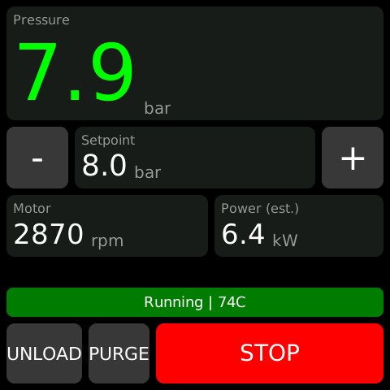
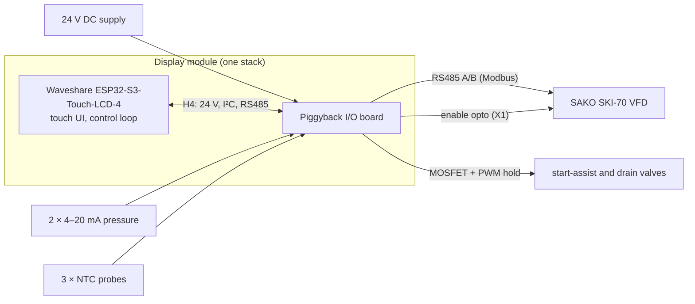
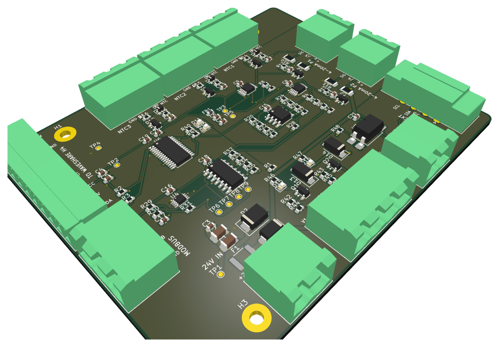
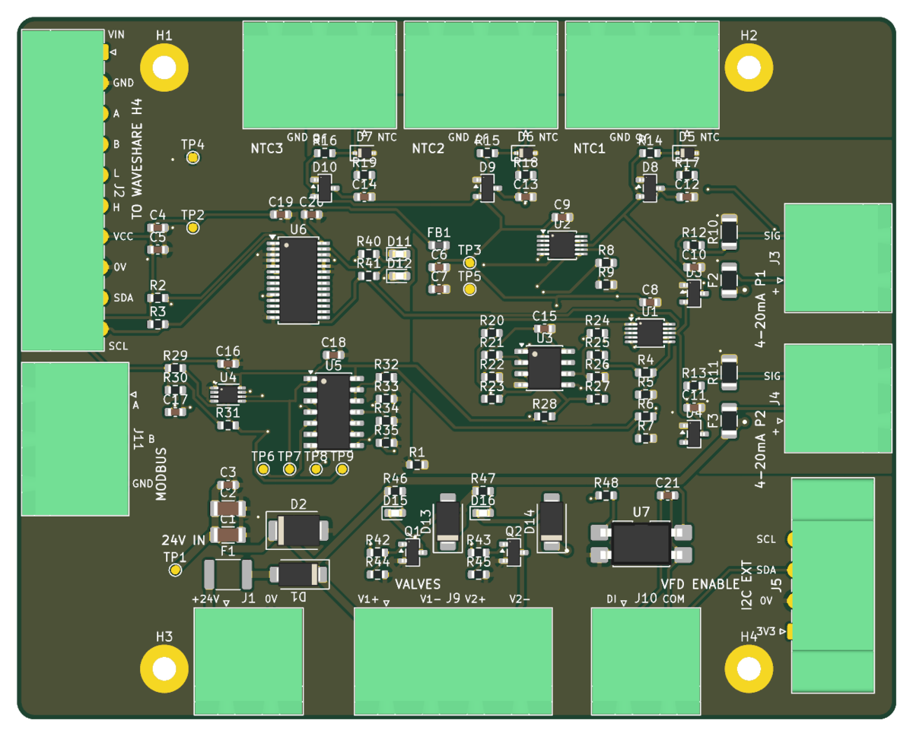
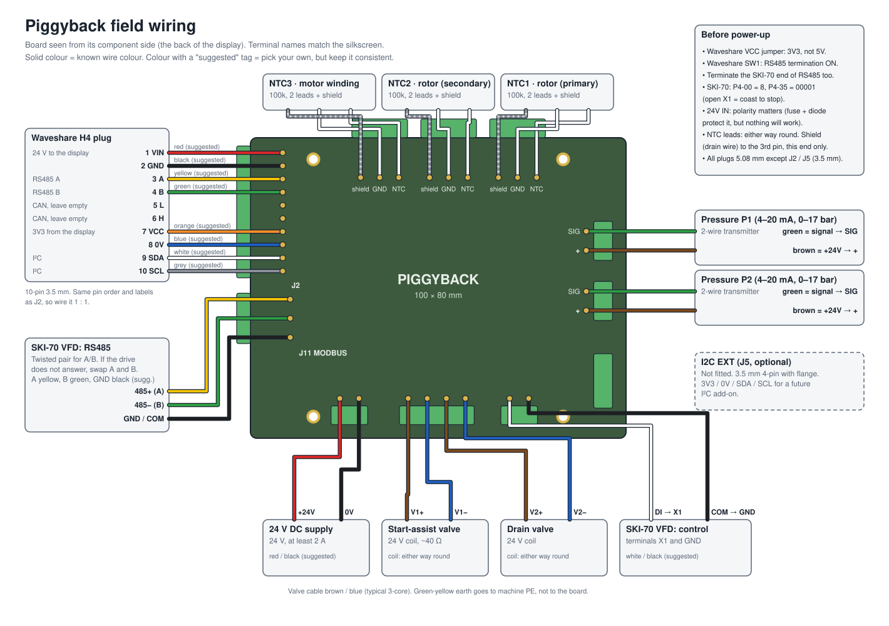
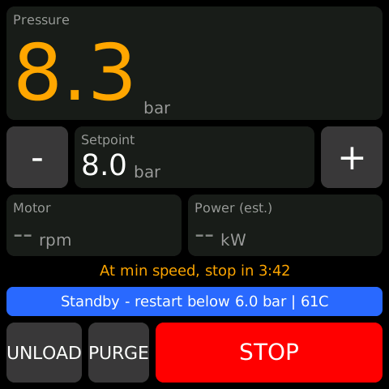
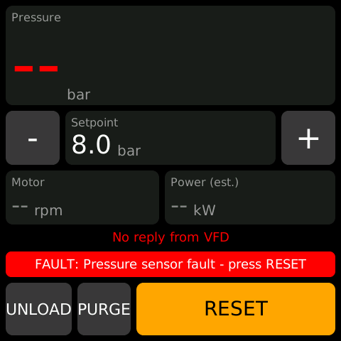

# Screw compressor controller

A replacement controller for a Ceccato ES3000-based 3-phase screw compressor
whose original control board died (blown triac, damaged optocouplers and
traces). It holds a pressure setpoint by running the motor's variable-frequency
drive at the right speed, watches the temperatures, and has a touch screen for
the operator.

<p align="center">
  
</p>

*The operator screen (480×480). Rendered from the real UI source with the same
renderer and fonts the board uses; see [Previewing the UI](#previewing-the-ui).*

## The machine

| | |
|---|---|
| Compressor | Ceccato ES3000 screw compressor, rated 10 bar, run at 8 bar |
| Motor | WEG W22 Premium, 7.5 kW, 400 V, 2-pole, 50 Hz |
| Drive | SAKO SKI-70 VFD, controlled entirely over Modbus RTU (no analog speed signal) |
| Sensors | 2 × 4–20 mA pressure transmitters (0–17 bar), up to 3 × 100k NTC probes |
| Valves | start-assist (blow-down to intake) and condensate drain, both 24 V solenoids |

There is no load/unload air valve. Capacity is controlled by VFD speed alone:
a PID loop holds the setpoint pressure. The start-assist valve only works
during the start-up ramp, and the drain is manual or timed.

## Hardware

Two boards, stacked and screwed together, in one enclosure:

1. **Waveshare ESP32-S3-Touch-LCD-4, Rev 4.0**: the brain and the display.
   ESP32-S3-WROOM-1-N16R8 (16 MB flash, 8 MB PSRAM), 4″ 480×480 panel
   (ST7701S, RGB interface), GT911 capacitive touch, a CH32V003 helper chip
   (panel and touch resets, backlight), and an onboard RS485 transceiver.
2. **The [piggyback](Piggyback/)**: a 100 × 80 mm SMD board, assembled by
   JLCPCB, that does everything the Waveshare can't. It connects to the
   Waveshare through its 10-pin H4 header only (power, I²C and the RS485 pair),
   because every ESP32-S3 pin is already used by the display.



### The piggyback

<p align="center">
  
</p>

| Block | Parts |
|---|---|
| Analog inputs | 2 × ADS1115 (16-bit, I²C): two 4–20 mA loops through 100 Ω shunts, three NTC dividers |
| Valve drive | PCA9685 PWM chip, low-side MOSFETs, flyback diodes (full drive to pull in, then a PWM hold) |
| Over-temperature cutout | LM393 comparators on the rotor and motor NTCs, independent of the firmware |
| Watchdog | 74LVC1G123 monostable: the firmware must toggle a heartbeat line about 5 times a second |
| Safety gating | 74LVC08: valves and the VFD enable output only work while the watchdog **and** the temperature cutout are OK |
| VFD enable | optocoupler on the drive's X1 input, set to coast-stop when open |

If the S3 hangs, the piggyback loses power, or a probe reads too hot, the
valves drop out and the VFD's enable input opens, which is set up to coast the
motor to a stop, with no software involved (the drive setting is still to be
verified on the real drive). The
full design, pin allocation and mounting are in
[Piggyback/README.md](Piggyback/README.md) and
[Piggyback/pin-allocation.md](Piggyback/pin-allocation.md).

<p align="center">
  
</p>

The piggyback screws to the back of the Waveshare on four 20 mm M2.5 standoffs:

```
 front ->  [ cover glass 84.2 x 84.2 ]
           [ Waveshare PCB 74.5 x 76.5 ]   H4 plug sticks out of its back face
                ||  4x M2.5 standoffs, 20 mm
           [ piggyback 100 x 80, parts facing away from the display ]
```

### Wiring



Only the pressure transmitter colours are fixed (brown = +24 V, green = signal). Every other colour marked "suggested" is a convention for this harness. Pick your own if you like, but use them consistently. The diagram is generated from the board's pad positions, so terminal order matches the silkscreen.

### VFD settings (SAKO SKI-70)

Set these on the drive's keypad before connecting the controller. Typically: PRG, arrows to the parameter, ENTER to edit, ENTER to store (check the manual for the exact keys).

| Parameter | Value | What it does |
|---|---|---|
| P0-02 | 2 | Run/stop commands come from comms (Modbus). |
| P0-03 | 9 | The speed setpoint comes from comms. |
| P0-12 | 35 Hz | Minimum frequency. The firmware reads it at start-up and keeps to the tighter of this and its own 35 Hz. |
| P0-14 | 50 Hz | Maximum frequency, also read at start-up. |
| Pd-00 | 5 | 9600 baud. |
| Pd-01 | 3 | 8N1 (8 data bits, no parity, 1 stop bit). |
| Pd-02 | 1 | Modbus address 1. |
| Accel / decel time | ≤ 5.5 s | The firmware assumes the motor is up to speed 5.5 s after a run command (`VFD_ACCEL_MS`). Parameter numbers are in the manual's P0 group. |
| Comms timeout | 2–3 s, stop or fault | If the manual's Pd group has one, set it. The controller talks to the drive every 0.5 s, so silence longer than this means the controller or the cable has failed. |

- **Recheck Pd-00..02 after a power cut.** They have been seen to reset. "VFD comms error" after an outage usually means this.
- Enter the motor nameplate data (and auto-tune, if offered) as the manual describes.

**Hardware stop on X1 (optional).** The piggyback can also stop the motor without the firmware: J10 (DI, COM) is an optocoupler that conducts only while SAFE is high. SAFE needs the watchdog heartbeat and the over-temperature comparator to be OK. Only set these if J10 DI is wired to X1 and COM to the drive's GND:

| Parameter | Value | What it does |
|---|---|---|
| P4-00 | 8 | X1 = coast to stop ("freely park"). Replaces the factory default 1 = FWD. |
| P4-35 | 00001 | X1 is active when low, so an open opto (SAFE low, controller dead, cable cut) coasts the motor. Modbus still controls run, stop and speed; X1 can only stop it. |

- **Without the X1 wire, leave both at their defaults.** P4-00 = 0 (no function) if the manual lists it, P4-35 = 00000. If you set them with X1 unwired, the open input means "stop" all the time and the motor never runs.
- When wired, test it: with the motor running over Modbus, unplug J10. The motor must coast to a stop.
- Don't use P4-00 = 32 ("outer failure normally close"). It latches Err15 at every power-up, before the heartbeat starts, and needs a manual reset each time.

## The screen

The UI is written in [Slint](https://slint.dev) and drawn by its software
renderer into a framebuffer in PSRAM. It shows the pressure large enough to read
from across the workshop, the setpoint with − and + buttons, motor speed and
estimated power, a status bar, and START / STOP / RESET plus hold-to-act UNLOAD
and PURGE buttons. Setpoint changes are saved to flash.

| Standby, minimum speed | Fault |
|---|---|
|  |  |

## Firmware

[Software/](Software/) is a `no_std` Rust program for the ESP32-S3:
[esp-hal](https://github.com/esp-rs/esp-hal) 1.0 with Embassy running on
`esp-rtos`.

| Module | What it does |
|---|---|
| `main.rs` | start-up, then one loop: read sensors, run the state machine, update the UI |
| `state_machine.rs` | Idle, Unloading (open-loop fill), Running (PID), UnloadIdle, Stopping, Fault; start-rate limit; over-pressure and over-temperature cutouts |
| `pid.rs`, `modbus.rs` | speed loop; Modbus RTU to the SKI-70 |
| `sensors.rs`, `valve.rs`, `outputs.rs` | 4–20 mA and NTC conversion; valve pull-in and PWM hold; heartbeat and status LEDs |
| `storage.rs` | start count, runtime and setpoint, kept in flash across power cycles |
| `ui.rs`, `ui/main.slint` | the screen and touch input |
| `board/` | drivers for the Waveshare board (panel, touch, expander) and the piggyback chips |

The control constants (pressure thresholds, temperature limits, VFD speed
limits, PID gains) are in `src/config.rs`. [Software/CLAUDE.md](Software/CLAUDE.md)
holds the long-form notes: what was measured, what was decided and why.

### Building and flashing

You need Espressif's Xtensa Rust toolchain (the S3 isn't supported by stock Rust):

```sh
cargo install espup espflash
espup install --targets esp32s3
. ~/export-esp.sh
```

Then, from `Software/`, with the board plugged into its USB-C port:

```sh
cargo run --release
```

This flashes over the board's USB-Serial-JTAG and shows the log. There is
also a `vfd-run-test` binary for exercising the drive on its own.

### How the display works

Driving a 480×480 RGB panel from PSRAM with a Rust HAL needed a few things
the HAL doesn't do for you. They are written up in the source:
[Software/src/board/display.rs](Software/src/board/display.rs) (scan-out from
SRAM bounce buffers, start order, vsync re-sync) and
[Software/src/board/st7701/](Software/src/board/st7701/) (the panel's init
sequence, with named registers).

## Status

- **Working on the bench:** display, touch, the UI, and saving the setpoint.
- **Next:** wiring up and testing the piggyback (sensors, valves, watchdog),
  then Modbus to the VFD on the new hardware.
- **Not done:** bold text in the UI (needs a variable font), and the control
  loop has not yet run against a real compressor on this hardware.

## Repository layout

| Path | Contents |
|---|---|
| [`Software/`](Software/) | the firmware (Rust) |
| [`Piggyback/`](Piggyback/) | the piggyback board: KiCad project, JLCPCB production files, notes |
| [`Main/`](Main/) | the original controller board, for the retired ESP32-C6 and Nextion design |
| [`THT/`](THT/) | a through-hole version of the breadboard controller, for hand soldering |
| [`docs/`](docs/) | images used in this README |
| [`tools/`](tools/) | `ui-preview`, which renders the UI to PNG |

The project started on an ESP32-C6 with a Nextion display. It moved to the
Waveshare S3 board in November 2026; the earlier design remains in the git
history.

## Previewing the UI

The screenshots above are not photographs. They are rendered on a computer from
`Software/ui/main.slint` with the same software renderer, fonts and RGB565 colour
depth as the board. To regenerate them after changing the UI:

```sh
cd tools/ui-preview
cargo run --release -- ../../docs/images
```

The scenes (running, standby, fault) are defined at the top of
`tools/ui-preview/src/main.rs`.

## Checks

The panel's init sequence is held to a golden test that needs no hardware:

```sh
cd Software/tools
rustc --edition 2024 -o /tmp/st7701_golden st7701_golden.rs && /tmp/st7701_golden
```

The beeper timing (docs/alerts.md) has one too:

```sh
cd Software/tools
rustc --edition 2024 -o /tmp/alarm_check alarm_check.rs && /tmp/alarm_check
```
