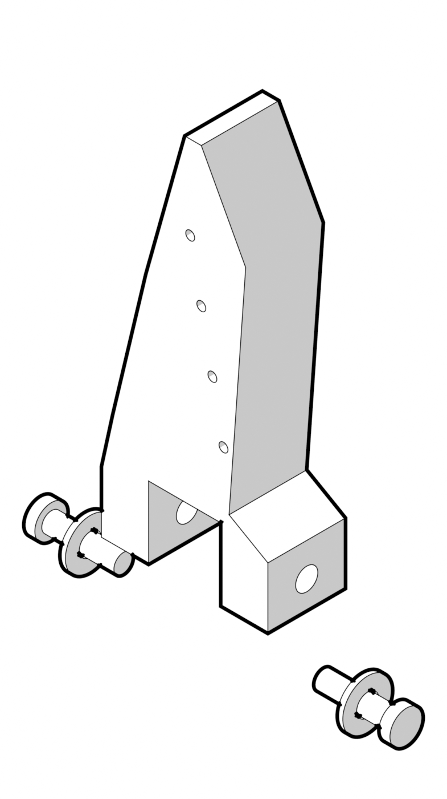

# stepline

Turn a STEP file into a parts-catalog style line drawing: orthographic isometric
view, heavy outer contour, thin interior edges, one flat grey on the shadow side,
white background, no gradients or cast shadows.



## Use

Needs [uv](https://docs.astral.sh/uv/) (it fetches `cadquery` for you) and
[Blender](https://www.blender.org/) 4.2+ on `PATH`.

```sh
uv run --python 3.12 tools/stepline/stepline.py part.step -o part.png
uv run --python 3.12 tools/stepline/stepline.py asm.step -o asm.png --explode 0.6
```

Each solid in the STEP becomes its own object, so every part gets its own outline.
Mesh inputs (`.stl .obj .glb .gltf .ply`) work too and skip the STEP stage.

| Flag | Default | Meaning |
|---|---|---|
| `--size` | 1600 | longest image side, px |
| `--azimuth` / `--elevation` | 45 / 35.264 | camera angles; defaults are true isometric |
| `--explode` | 0 | push parts apart along their dominant axis (try 0.4–1.2) |
| `--outline` / `--detail` | 5 / 1.3 | outer-contour and interior line weight (scaled to image size) |
| `--shade` | 0.78 | sRGB grey of the shadow side |
| `--crease` | 134 | faces meeting at less than this angle get an edge line |
| `--tol` | 0.05 | STEP tessellation tolerance in model units |

## Browser demo

`web/index.html` is a self-contained WebGL port: OpenCascade compiled to wasm
([occt-import-js](https://github.com/kovacsv/occt-import-js)) parses the STEP in the
page, three.js draws it with the same two-tone shading, and a post-process pass inks
the outlines. Drag to rotate, or drop your own `.step` file on the page; it never
leaves the browser. Serve the `tools/stepline` folder (the page fetches `../examples/`):

```sh
python3 -m http.server 8765 --directory tools/stepline   # then open /web/
```

Three.js and occt-import-js load from jsDelivr at pinned versions.

## How it works

`stepline.py` tessellates each solid to STL with cadquery/OpenCASCADE, then runs
`blender_style.py` headless: an orthographic camera, an emission-only toon material
(Shader to RGB, two-step ramp) lit by a single shadowless sun, and two Freestyle
line sets: external contour (thick) and crease/silhouette/border (thin).

`examples/make_example.py` regenerates `examples/bracket.step`, original geometry
made for this repo.
